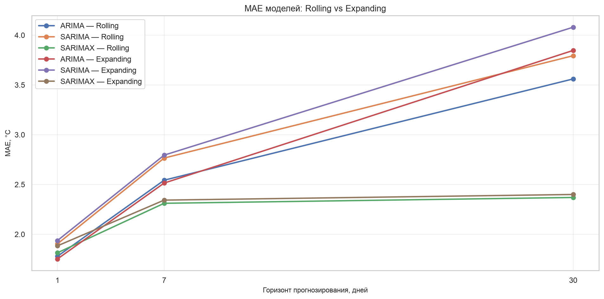
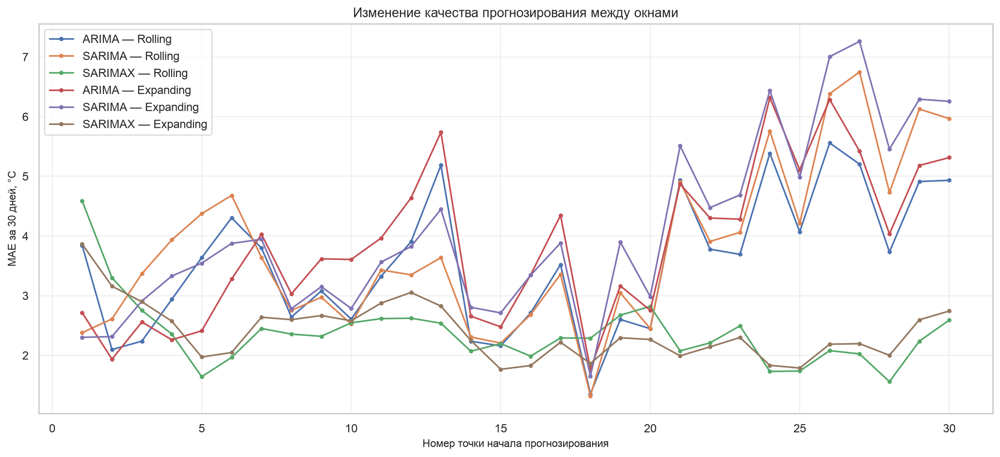
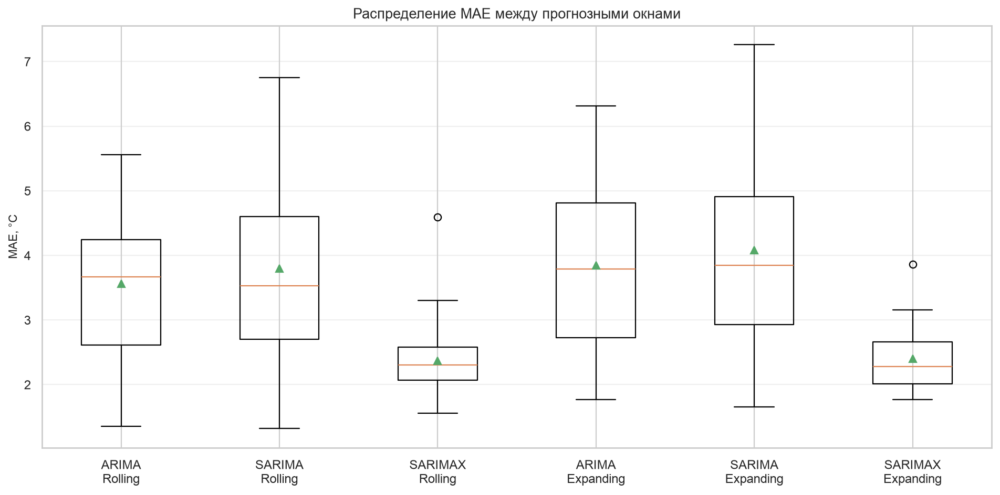

# Итоговый аналитический отчёт

## Исследование и прогнозирование временного ряда
## среднесуточной температуры воздуха в Москве

**Практическая работа №3**

**Направление:** Бизнес-информатика

**Предмет исследования:** среднесуточная температура воздуха

**Период наблюдений:** 2024–2025 годы

**Количество наблюдений:** 731

**Методы:** ARIMA, SARIMA, SARIMAX, Prophet, методы
экспоненциального сглаживания, авторегрессионные
модели и стратегии многошагового прогнозирования.

---

## 1. Введение

Прогнозирование временных рядов представляет собой
важное направление анализа данных, позволяющее
исследовать закономерности изменения показателей
во времени и оценивать их будущие значения.

В данной работе рассматривается задача прогнозирования
среднесуточной температуры воздуха в Москве на основе
ежедневных наблюдений за 2024–2025 годы.

Температурный временной ряд характеризуется выраженной
годовой сезонностью, краткосрочными колебаниями
и наличием случайных изменений.

Эти особенности позволяют исследовать возможности
классических статистических методов прогнозирования
и сравнить их эффективность на различных горизонтах.

### Цель исследования

Разработать и исследовать методы прогнозирования
среднесуточной температуры, определить наиболее
эффективные модели для горизонтов 1, 7 и 30 дней
и реализовать программный инструмент для их применения.

### Основные задачи

1. Подготовить временной ряд и проверить его стационарность.
2. Исследовать структуру признаков и мультиколлинеарность.
3. Сравнить стратегии многошагового прогнозирования.
4. Обучить классические статистические модели.
5. Оценить качество прогнозов и диагностировать остатки.
6. Проверить устойчивость моделей и отсутствие утечек.
7. Провести Rolling и Expanding Backtesting.
8. Разработать программный интерфейс и веб-приложение.
9. Выполнить автоматизированное тестирование.
10. Сформулировать практические рекомендации.

## 2. Описание исходных данных

Исследование выполнено на временном ряду среднесуточной
температуры воздуха в Москве.

Набор данных содержит 731 ежедневное наблюдение
за период 2024–2025 годов.

Целевая переменная — `temperature_2m_mean`.

Данные упорядочены по времени, имеют дневную частоту
и не содержат пропущенных календарных дат.

Для основных экспериментов использовалось
хронологическое разделение:

- обучающая выборка — 584 наблюдения;
- тестовая выборка — 147 наблюдений.

Случайное перемешивание наблюдений не применялось,
поскольку оно нарушило бы временную структуру данных.

В исходном исследовании также использовались
лаговые, скользящие, календарные и производные признаки.

При построении будущих прогнозов необходимо учитывать,
какие из этих признаков действительно доступны
на момент формирования прогноза.

## 3. Предварительный анализ и стационарность

Для исследования стационарности применялись тесты
Дики — Фуллера (ADF) и KPSS.

### Результаты проверки исходного ряда

| Тест | Статистика | p-value |
|---|---:|---:|
| ADF | -3.203027 | 0.019810 |
| KPSS | 0.323900 | ≥ 0.100000 |

При уровне значимости 0,05 тест ADF позволяет
отвергнуть гипотезу о наличии единичного корня.

Тест KPSS не даёт оснований отвергнуть гипотезу
стационарности относительно использованной
в тесте детерминированной компоненты.

В рамках выбранных спецификаций тестов
полученные результаты согласуются
с предположением о стационарности ряда.

### Результаты для первой разности

| Тест | Статистика | p-value |
|---|---:|---:|
| ADF | -14.095812 | 2.67e-26 |
| KPSS | 0.318994 | ≥ 0.100000 |

Первая разность также продемонстрировала
признаки стационарности.

Поскольку исходный ряд прошёл выбранные проверки,
для последующего моделирования использовалось
дифференцирование порядка `d = 0`.

При этом статистическая стационарность
по результатам тестов не исключает
наличия выраженной годовой сезонности.

Обратное преобразование для выбранного
тождественного преобразования выполнено
без численных расхождений.

## 4. Отбор и исследование признаков

Для исследования мультиколлинеарности применялся
коэффициент инфляции дисперсии (VIF).

На обучающей выборке были рассмотрены
197 числовых признаков.

После исключения 12 константных признаков
для анализа осталось 185 переменных.

### Результаты VIF

| Показатель | Значение |
|---|---:|
| Числовых признаков | 197 |
| Исключено константных | 12 |
| Признаков до VIF | 185 |
| Исключено при итеративном VIF | 91 |
| Признаков после VIF | 94 |
| Максимальный итоговый VIF | 9.6773 |

В ходе анализа обнаружены случаи точной линейной
зависимости между отдельными лаговыми
и производными признаками.

После итеративного исключения переменных
максимальное значение VIF стало меньше 10.

Количество признаков уменьшилось приблизительно
на 49,2%.

### Корреляционный анализ

| Показатель | До VIF | После VIF |
|---|---:|---:|
| Количество пар | 17020 | 4371 |
| Средняя абсолютная корреляция | 0.2313 | 0.1004 |
| Пар с корреляцией выше 0.8 | 988 | 1 |
| Пар с корреляцией выше 0.9 | 397 | 0 |

Средняя абсолютная корреляция между признаками
уменьшилась приблизительно на 56,6%.

Таким образом, применение VIF позволило
существенно сократить мультиколлинеарность
и сформировать более компактное пространство признаков.

При этом снижение корреляции не гарантирует
повышения прогнозной точности, поэтому
эффективность отбора признаков необходимо
проверять на отложенных данных.

Отдельного контроля требуют производные признаки,
которые могут использовать значение целевой
переменной текущего дня.

## 5. Стратегии многошагового прогнозирования

В отдельном эксперименте сравнивались стратегии
Recursive, Direct и Hybrid на основе модели Ridge.

### Основные результаты

| Горизонт | Стратегия | MAE | RMSE |
|---|---|---:|---:|
| 1 | Recursive | 1.6475 | 2.2139 |
| 1 | Direct | 1.6475 | 2.2139 |
| 1 | Hybrid | 1.6475 | 2.2139 |
| 7 | Recursive | 2.4607 | 3.2184 |
| 7 | Hybrid | 2.4887 | 3.2481 |
| 7 | Direct | 2.4899 | 3.2494 |
| 30 | Hybrid | 2.4169 | 3.0831 |
| 30 | Direct | 2.4380 | 3.1121 |
| 30 | Recursive | 2.5113 | 3.1378 |

На горизонте одного дня результаты стратегий совпали.

На семидневном горизонте наименьшую ошибку
показала Recursive.

На горизонте 30 дней наиболее точной
оказалась Hybrid.

Полученные результаты подтверждают,
что эффективность стратегии зависит
от горизонта прогнозирования.

Данный эксперимент проводился отдельно
от классических моделей ARIMA, SARIMA
и SARIMAX, поэтому его результаты
не следует напрямую отождествлять
с результатами их бэктестинга.

## 6. Сравнение классических моделей

В ходе исследования рассматривались
авторегрессионные модели, ARIMA, SARIMA,
SARIMAX, методы экспоненциального сглаживания,
Prophet и базовые прогнозы.

Модель GARCH(1,1) исследовалась
как дополнительный инструмент моделирования
условной дисперсии остатков ARIMA.

Модели VAR/VECM не применялись,
поскольку в рассматриваемой постановке
отсутствовали два или более обоснованно
связанных временных ряда для совместного
многомерного моделирования.

### Фиксированный прогноз на 30 дней

| Модель | MAE | RMSE |
|---|---:|---:|
| SARIMA | 2.3003 | 2.8707 |
| ARIMA | 2.7154 | 3.1466 |
| SARIMAX | 3.8649 | 4.1886 |

На одном фиксированном 30-дневном интервале
лучшую точность показала SARIMA.

Однако оценка на одном интервале
не позволяет сделать окончательный вывод
об устойчивости модели.

Поэтому в последующих заданиях применялись
многократные прогнозные эксперименты.

### Результаты обучения из задания 10

| model | status | MAE | RMSE |
| --- | --- | --- | --- |
| ARIMA | OK | 2.7154 | 3.1466 |
| SARIMA | OK | 2.3003 | 2.8707 |
| SARIMAX | OK | 3.8649 | 4.1886 |

## 7. Статистическая диагностика моделей

Для оценки статистической адекватности
использовались:

- тест Льюнга — Бокса;
- тест Шапиро — Уилка;
- тест Бройша — Пагана;
- анализ ACF и PACF остатков;
- анализ устойчивости коэффициентов SARIMAX.

### Результаты диагностики

| Модель | Ljung–Box p (лаг 30) | Shapiro p | BP p |
|---|---:|---:|---:|
| ARIMA | 0.338435 | <0.000001 | 0.000191 |
| SARIMA | 0.034961 | <0.000001 | 0.000471 |
| SARIMAX | 0.101174 | 0.000001 | 0.000055 |

Значения Ljung–Box приведены
по диагностике задания 6 с учётом
использованной поправки на число параметров.

Для ARIMA и SARIMAX на лаге 30
не обнаружено оснований отвергать
гипотезу об отсутствии автокорреляции.

Для SARIMA обнаружены признаки
остаточной автокорреляции.

Все три модели продемонстрировали
отклонение распределения остатков
от нормального.

Тест Бройша — Пагана выявил
статистически значимые признаки
неоднородности дисперсии остатков.

Следовательно, ни одна модель
не удовлетворяет всем рассмотренным
диагностическим критериям.

Это ограничивает надёжность
стандартных прогнозных интервалов
и требует осторожной интерпретации
их вероятностного покрытия.

## 8. Интерпретация параметров моделей

В ARIMA(5,0,2) статистически значимыми
оказались отдельные авторегрессионные
коэффициенты, в том числе при лагах
2, 3 и 5, а также коэффициенты
скользящего среднего.

В SARIMA статистически значимыми
оказались рассмотренные параметры,
включая сезонные компоненты
с периодом 7 дней.

В SARIMAX использовались
годовые гармонические признаки.

Коэффициенты первой годовой гармоники
были статистически значимыми:

- annual_sin_1 = -3.6231;
- annual_cos_1 = -11.8534.

Амплитуда первой гармоники составила
приблизительно 12,39 °C.

Коэффициенты второй гармоники
не продемонстрировали статистической
значимости при уровне 0,05.

Полученные результаты указывают
на существенную роль годовой сезонности
в изменении температуры.

При этом интерпретация отдельных
коэффициентов требует учитывать
параметризацию модели и взаимодействие
между авторегрессионными,
сезонными и экзогенными компонентами.

## 9. Проверка устойчивости и отсутствия утечек

В ходе исследования проверялись
хронологический порядок наблюдений,
уникальность дат, непрерывность ряда,
отсутствие пересечения обучающего
и прогнозного интервалов.

Дополнительно проводились эксперименты
с внесением случайного шума
в обучающие наблюдения.

### Чувствительность к шуму

При добавлении шума со стандартным
отклонением 1 °C средние MAE составили:

| Модель | Без шума | Шум 1 °C |
|---|---:|---:|
| ARIMA | 2.7154 | 3.1625 |
| SARIMA | 2.3003 | 3.8168 |
| SARIMAX | 3.8649 | 3.7970 |

SARIMA продемонстрировала наиболее
сильное ухудшение средней ошибки
в данном эксперименте.

SARIMAX показала меньшую чувствительность
к добавленному шуму, однако её
исходная ошибка на фиксированном
интервале была выше.

Эксперимент проводился с ограниченным
числом повторений, поэтому результаты
следует рассматривать как оценку
чувствительности в конкретной постановке,
а не как универсальную характеристику
устойчивости моделей.

Проверки отсутствия утечек
подтвердили корректность временного
разделения данных в исследованных сценариях.

Вместе с тем эти проверки не заменяют
полного аудита происхождения
каждого используемого признака.

## 10. Rolling и Expanding Backtesting

Для проверки стабильности моделей
реализованы две стратегии:

**Rolling Window** — обучение на последних
365 доступных наблюдениях.

**Expanding Window** — обучение на всех
наблюдениях, доступных до текущей
точки начала прогнозирования.

Использованы 30 точек начала прогноза
и горизонты 1, 7 и 30 дней.

Всего выполнено 180 обучений моделей.
Все обучения завершились успешно.

Проведено 60 проверок отсутствия
пересечения обучающих и прогнозных
интервалов. Все проверки пройдены.

Общее время эксперимента — 88,73 секунды.

### Лучшие результаты

| Горизонт | Модель | Стратегия | MAE | RMSE |
|---|---|---|---:|---:|
| 1 | ARIMA | Expanding | 1.7514 | 2.3019 |
| 7 | SARIMAX | Rolling | 2.3105 | 2.8986 |
| 30 | SARIMAX | Rolling | 2.3689 | 3.0119 |

На однодневном горизонте
лучшей оказалась ARIMA Expanding.

На горизонтах 7 и 30 дней
наименьшую MAE показала SARIMAX Rolling.

На 30-дневном горизонте SARIMAX Rolling
снизила MAE примерно на 33,5%
по сравнению с лучшей ARIMA.

Стратегия Rolling оказалась лучше
Expanding в 7 из 9 сравнений.

SARIMAX Expanding продемонстрировала
минимальное стандартное отклонение
MAE между окнами на горизонте 30 дней,
а SARIMAX Rolling — минимальную
среднюю ошибку.

### Методологические ограничения

Прогнозы соседних точек частично
перекрываются, поэтому отдельные
прогнозные ошибки не являются
полностью независимыми.

Метрики горизонта h рассчитаны
по всем шагам от 1 до h.

Кроме того, в каждой точке
начала прогноза модель обучалась
на доступных к этой дате наблюдениях.

Поэтому результаты характеризуют
качество моделей при регулярном
переобучении, а не при единственном
долгосрочном прогнозе.

### Полная таблица бэктестинга

| strategy | model | horizon | successful_origins | MAE | RMSE | bias | origin_MAE_std | mean_fit_time_sec |
| --- | --- | --- | --- | --- | --- | --- | --- | --- |
| Expanding | ARIMA | 1 | 30 | 1.7514 | 2.3019 | 0.5124 | 1.5193 | 0.2238 |
| Rolling | ARIMA | 1 | 30 | 1.7781 | 2.3235 | 0.4756 | 1.5213 | 0.1611 |
| Rolling | SARIMAX | 1 | 30 | 1.8132 | 2.2848 | 0.4761 | 1.414 | 0.5284 |
| Expanding | SARIMAX | 1 | 30 | 1.883 | 2.2498 | 0.4954 | 1.2523 | 1.2042 |
| Rolling | SARIMA | 1 | 30 | 1.9028 | 2.4793 | 0.5361 | 1.6167 | 0.361 |
| Expanding | SARIMA | 1 | 30 | 1.936 | 2.4881 | 0.4683 | 1.5895 | 0.4653 |
| Rolling | SARIMAX | 7 | 30 | 2.3105 | 2.8986 | 0.3092 | 1.0547 | 0.5284 |
| Expanding | SARIMAX | 7 | 30 | 2.3423 | 2.8778 | 0.6977 | 1.0395 | 1.2042 |
| Expanding | ARIMA | 7 | 30 | 2.5137 | 3.2485 | 0.924 | 1.3879 | 0.2238 |
| Rolling | ARIMA | 7 | 30 | 2.5424 | 3.2755 | 0.7539 | 1.4425 | 0.1611 |
| Rolling | SARIMA | 7 | 30 | 2.7648 | 3.4735 | 0.71 | 1.4635 | 0.361 |
| Expanding | SARIMA | 7 | 30 | 2.7942 | 3.528 | 0.8965 | 1.5123 | 0.4653 |
| Rolling | SARIMAX | 30 | 30 | 2.3689 | 3.0119 | 0.0961 | 0.5656 | 0.5284 |
| Expanding | SARIMAX | 30 | 30 | 2.399 | 2.9927 | 0.5117 | 0.4839 | 1.2042 |
| Rolling | ARIMA | 30 | 30 | 3.5597 | 4.4464 | 2.1133 | 1.1332 | 0.1611 |
| Rolling | SARIMA | 30 | 30 | 3.7928 | 4.7428 | 1.8862 | 1.3767 | 0.361 |
| Expanding | ARIMA | 30 | 30 | 3.8459 | 4.7923 | 2.6771 | 1.2846 | 0.2238 |
| Expanding | SARIMA | 30 | 30 | 4.0791 | 5.056 | 2.5273 | 1.4811 | 0.4653 |

### Сравнение Rolling и Expanding

| model | horizon | Expanding | Rolling | Rolling_minus_Expanding | best_strategy |
| --- | --- | --- | --- | --- | --- |
| ARIMA | 1 | 1.7514 | 1.7781 | 0.0267 | Expanding |
| ARIMA | 7 | 2.5137 | 2.5424 | 0.0288 | Expanding |
| ARIMA | 30 | 3.8459 | 3.5597 | -0.2862 | Rolling |
| SARIMA | 1 | 1.936 | 1.9028 | -0.0332 | Rolling |
| SARIMA | 7 | 2.7942 | 2.7648 | -0.0294 | Rolling |
| SARIMA | 30 | 4.0791 | 3.7928 | -0.2864 | Rolling |
| SARIMAX | 1 | 1.883 | 1.8132 | -0.0698 | Rolling |
| SARIMAX | 7 | 2.3423 | 2.3105 | -0.0318 | Rolling |
| SARIMAX | 30 | 2.399 | 2.3689 | -0.0301 | Rolling |

## 11. Программная реализация

В ходе работы разработан отдельный
Python-модуль `forecasting_wrapper.py`.

Он содержит класс `ForecastingWrapper`
для унифицированной работы с моделями
ARIMA, SARIMA и SARIMAX.

Реализованы методы:

- `fit()` — обучение модели;
- `predict()` — прогноз для будущего интервала;
- `forecast()` — многошаговый прогноз;
- `diagnose()` — статистическая диагностика;
- `save()` — сериализация;
- `load()` — восстановление модели;
- `get_params()` — параметры модели;
- `get_config()` — конфигурация.

Проверка сериализации показала
полное совпадение прогнозов
до сохранения и после восстановления
для всех трёх моделей.

### Автоматизированное тестирование

Разработан набор тестов на основе pytest.

При запуске было собрано 28 тестовых
случаев, включая параметризованные проверки.

Тестирование завершилось
с успешным кодом выполнения.

Проверялись обучение, прогнозирование,
обработка некорректных данных,
диагностика и сериализация.

### Интерактивное приложение

На основе Streamlit разработано
веб-приложение `app.py`.

Приложение позволяет:

- загружать CSV-файлы;
- выбирать целевую переменную;
- настраивать параметры модели;
- строить прогнозы;
- просматривать прогнозные интервалы;
- рассчитывать MAE, RMSE и Bias;
- просматривать результаты диагностики;
- скачивать CSV-прогноз и JSON-отчёт;
- сохранять обученные модели.

Приложение успешно запущено
и проверено в локальном окружении.

Для классических моделей реализована
рекурсивная схема многошагового прогноза.

Интерфейс загрузки ранее сохранённых
файлов `.joblib`, а также стратегии
Direct и Hybrid для классических моделей
в текущей версии не реализованы.

## 12. Ограничения исследования

В ходе исследования выявлены
следующие ограничения.

### Ограниченный период наблюдений

Временной ряд охватывает два календарных года.
Для более надёжной оценки годовой сезонности
желательно использовать более продолжительную
историю наблюдений.

### Особенности статистических моделей

Ни одна из основных моделей
не удовлетворила всем рассмотренным
диагностическим критериям.

Выявлены отклонения от нормальности
и признаки неоднородности дисперсии остатков.

### Различия в схемах оценки

Фиксированный прогноз, последовательные
прогнозные окна и бэктестинг с переобучением
представляют разные экспериментальные схемы.

Их результаты нельзя сравнивать
без учёта методики формирования
обучающих и тестовых интервалов.

### Перекрытие прогнозных окон

В бэктестинге использовались
перекрывающиеся прогнозные интервалы,
что создаёт зависимость между ошибками.

### Ограниченная оценка устойчивости

Эксперименты с добавлением шума
проводились с ограниченным количеством
повторений.

### Функциональные ограничения приложения

Текущая версия Streamlit-приложения
поддерживает рекурсивное прогнозирование
классическими моделями.

Отдельные стратегии Direct и Hybrid
и пользовательская загрузка сохранённых
моделей могут быть реализованы
в дальнейшем.

## 13. Практические рекомендации

На основании результатов проведённого
бэктестинга предлагаются следующие
рекомендации.

### Прогнозирование на один день

Рекомендуется использовать
ARIMA(5,0,2) со стратегией Expanding Window.

Данная комбинация показала
минимальную MAE = 1,7514 °C.

Дополнительным преимуществом
ARIMA являются относительно низкие
вычислительные затраты.

### Прогнозирование на 7 дней

Рекомендуется использовать SARIMAX
со стратегией Rolling Window.

Полученная MAE составила 2,3105 °C.

### Прогнозирование на 30 дней

Рекомендуется использовать SARIMAX
со стратегией Rolling Window.

Полученная MAE составила 2,3689 °C.

При этом SARIMAX Expanding также
показала близкую точность и несколько
меньший разброс MAE между окнами.

### Рекомендации по развитию решения

Для повышения качества исследования
и программного продукта целесообразно:

1. Увеличить временной период наблюдений.
2. Провести дополнительную настройку гиперпараметров.
3. Исследовать корректность покрытия прогнозных интервалов.
4. Добавить дополнительные метеорологические факторы,
   доступные на момент прогнозирования.
5. Повторить бэктестинг на других временных периодах.
6. Добавить интерфейс загрузки сохранённых моделей.
7. Реализовать дополнительные стратегии
   многошагового прогнозирования.
8. Проверить статистическую значимость
   различий между моделями с учётом
   зависимости прогнозных ошибок.

## 14. Заключение

В рамках практической работы выполнено
комплексное исследование временного ряда
среднесуточной температуры воздуха в Москве.

Подготовлен непрерывный дневной временной ряд
из 731 наблюдения.

Проведены проверки стационарности
с использованием тестов ADF и KPSS.

Выполнен отбор признаков с применением VIF.
Количество исследуемых признаков
сокращено со 185 до 94.

Сравнены стратегии Recursive, Direct
и Hybrid, а также классические
статистические модели прогнозирования.

Проведены диагностика остатков,
интерпретация коэффициентов,
проверки устойчивости и отсутствия утечек.

В ходе Rolling и Expanding Backtesting
выполнено 180 успешных обучений моделей.

По результатам бэктестинга
для прогноза на один день
рекомендуется ARIMA Expanding,
а для горизонтов 7 и 30 дней —
SARIMAX Rolling.

Разработан универсальный
программный интерфейс ForecastingWrapper.

Создано и успешно запущено
интерактивное приложение Streamlit.

Проведено автоматизированное
тестирование программной реализации.

Таким образом, основные задачи
практической работы выполнены.

Полученные результаты демонстрируют
возможность применения классических
методов анализа временных рядов
для прогнозирования температуры
и создания прикладного программного
инструмента на их основе.

## Приложение А. Графические материалы

Ниже представлены графики, сохранённые
в ходе предыдущих заданий.

